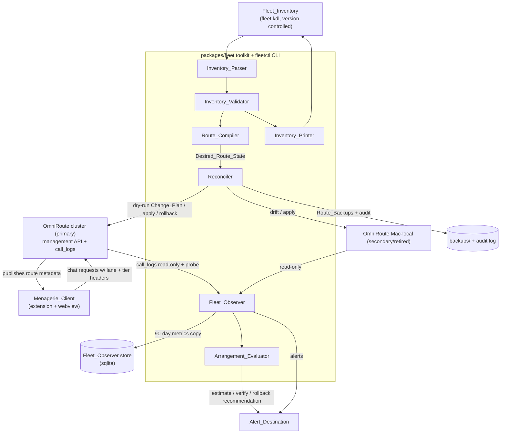

# Design Document

## Overview

This design turns the OmniRoute inference fleet into a declarative system. The operator describes every device, serving endpoint, model, lane, and OmniRoute instance once, in a single version-controlled **Fleet_Inventory**. A **Route_Compiler** generates the full combo set, concurrency limits, and published route metadata from that inventory. A **Reconciler** diffs the generated state against each live OmniRoute instance, previews a change plan, backs up, applies, verifies, and can roll back. A **Fleet_Observer** computes per-card and per-route metrics and raises runtime alerts. An **Arrangement_Evaluator** scores candidate GPU layouts against measured baselines. Menagerie becomes a thinner client that reads route metadata OmniRoute publishes instead of carrying hard-coded fleet facts.

The design satisfies the 22 requirements in `requirements.md` and is grounded in the measured current state in `.agents/tasks/omniroute-fleet-topology/findings.md`. It also carries the forward-looking decisions the requirements left open; those are tracked in `.agents/tasks/omniroute-fleet-topology/open-items.md` and surfaced here as design decisions with a stated default.

The work spans three codebases that already exist and whose stacks are fixed:

- **The fleet toolkit** (new): a TypeScript package `packages/fleet` in the menagerie monorepo (pnpm 10.8.1, Node 22.23.1, TypeScript, Zod 3.25, Vitest 4.1, `fast-check` 3.23 for property tests, `commander` for the CLI, `better-sqlite3` opened read-only for metrics). It holds the Inventory_Parser/Printer/Validator, Route_Compiler, Reconciler, Fleet_Observer, and Arrangement_Evaluator, plus a `fleetctl` CLI. It talks to OmniRoute over the management HTTP API and reads call logs read-only. It is a build-time and operator tool, not part of the extension host.
- **OmniRoute** (`/Users/celes/sources/celesrenata/OmniRoute`, Next.js, branch `release/v3.8.52`): small additive changes to publish route metadata on the VS Code combos endpoint, to record attempt attribution and admission wait in call logs, and to emit a structured busy-slot-skip signal. No change to combo-scheduling semantics.
- **Menagerie extension/webview**: the Menagerie_Client reads published route context windows, capacity, and lane routes instead of the two hard-coded maps (`OMNIROUTE_ROUTE_CONTEXT_WINDOWS`, `STATIC_ROUTE_CAPACITY`), flags saved profiles that point at missing/internal/direct routes, and attaches a Capability_Lane name to each request. This reuses the existing OmniRoute-opt-in OpenAI provider profile and the `fetchOmniRouteCatalog` message path.

The design deliberately keeps three ownership boundaries from the companion architecture doc (`docs/architecture/omniroute-integration-design.md`): OmniRoute owns routing, tiering, and placement; the Fleet_Topology_System owns the declarative description and reconciliation of that placement; Menagerie stays a thin client that selects a route name and reads published metadata.

### Why a separate toolkit instead of extending the generator

The current generator (`omniroute-mode.py`, 448 lines on a GPU host) rewrites a subset of combos and copies the rest from live, which is the root of the drift the findings measured (63 of 90 shared combos changed since the Oct 4 snapshot; reader/fast/tester intent never reaches live). A full compiler that emits the complete desired state, plus a reconciler that treats any un-generated combo as drift, is the smallest change that makes the live set reproducible. Putting it in the monorepo (not on a GPU host, not in the OmniRoute repo) keeps one versioned owner, lets it share the `@roo-code/types` Zod vocabulary with the Menagerie_Client, and lets both read the same inventory.

## Architecture



The toolkit is the only writer to OmniRoute, and only in apply or rollback mode with per-invocation operator confirmation (Requirement 22). Every other path is read-only. The Menagerie_Client never writes routing state; it reads published metadata and sends requests.

### Component responsibilities

| Component | Owns | Reads | Writes |
|---|---|---|---|
| Inventory_Parser / Printer | Fleet_Inventory text ↔ model, round-trip | inventory document | inventory document (printer) |
| Inventory_Validator | referential, numeric, allocation, uniqueness, route-name, role, secret checks | inventory model | nothing |
| Route_Compiler | Desired_Route_State per Managed_Instance, deterministic | inventory model | nothing (pure) |
| Reconciler | drift, Change_Plan, backup, apply, readback, rollback, audit | compiled state + live OmniRoute | OmniRoute (apply/rollback only), backups, audit |
| Fleet_Observer | per-card/route metrics, anomaly alerts, 90-day metrics copy | OmniRoute call logs + probes | metrics store, alerts |
| Arrangement_Evaluator | estimate, evaluation window, floors, ranking | metrics store + inventory | reports, rollback recommendations |
| Menagerie_Client | consume published metadata, flag bad routes, attach lane/tier | published route catalog | extension state only |

## Components and Interfaces

### 1. Fleet_Inventory format and parsing (Requirements 1, 2)

#### Decision: KDL document, one file, in the menagerie monorepo

Two format options were considered.

- **(A) YAML/JSON.** Ubiquitous, but anchors/aliases and loose typing invite exactly the "declared in many places, drifting by hand" problem the findings call out, and comments are second-class.
- **(B) KDL** (`kdl-org`, a small node-based config language). Comment-friendly, strongly nested, stable round-trip, and a tiny parser surface.

**Chosen: (B) KDL**, stored at `fleet/fleet.kdl` in the menagerie repo, parsed with the `kdljs` library (added to `packages/fleet`). The decision is reversible: the parser/printer boundary (below) isolates the format, so only two files change if we revisit it. The round-trip property (Requirement 2.4) and determinism of compilation (Requirement 5.2) are what matter, not the surface syntax.

Rejected: keeping the inventory in `nix-flakes-refactored` on the GPU host. The Menagerie_Client must read the same lane and route vocabulary, and the compiler must share the `@roo-code/types` Zod schemas; a monorepo location gives one owner and one test suite. Host serving configuration stays in the nix flakes (a stated non-goal); the inventory declares the *expected* host values and the Reconciler's Preflight_Check verifies them.

#### Document shape

```kdl
// fleet/fleet.kdl  — single source of truth for OmniRoute routing
revision-note "free-form; the real revision id is the git commit that last changed this file"

alert-destination url="https://alerts.internal/omniroute" secret="alert_webhook_token"

instance "cluster" role="primary" address="https://omniroute.celestium.life" secret="omniroute_management_api_key" {
  backup-retention 20
}
instance "mac-local" role="retired" address="http://127.0.0.1:20128" no-credential=true

device "rtx5090" slot-ceiling=2 host-preemption=true
device "rtx4070ti" slot-ceiling=4 host-preemption=false
device "m5max" slot-ceiling=2 host-preemption=false
device "arc-ml-1" slot-ceiling=6 host-preemption=false
// ...arc-ml-2..4

endpoint "esnixi-vllm" provider="vllm" devices="rtx5090" {
  address instance="cluster" url="http://192.168.133.3:2701"
  secret "vllm_switcher_key"
}
endpoint "gremlin-ollama" provider="ollama-local" devices="rtx4070ti" {
  address instance="cluster" url="http://ollama-service.omniroute.svc:2701"
  no-credential true
}
endpoint "m5-proxy" provider="llama-cpp" devices="m5max" {
  address instance="cluster" url="http://192.168.133.2:7777"
  no-credential true
}
endpoint "arc-ovms-embed" provider="ovms-arc" devices="arc-ml-1 arc-ml-2 arc-ml-3 arc-ml-4" {
  address instance="cluster" url="http://ovms-embeddings.omniroute-memory.svc:8000"
  no-credential true
}

model "coder-5090" endpoint="esnixi-vllm" device="rtx5090" id="qwen3.8-27b-nvfp4" \
  context=163840 slots=2 residency="r-5090" tags="chat code reasoning tools vision-no" {
  rank 1   // slot 1
  rank 6   // slot 2 (second sequence is slower; see f2 in the replay)
}
model "coder-4070" endpoint="gremlin-ollama" device="rtx4070ti" id="qwen3.8:27b-iq3-code144k" \
  context=147456 slots=1 residency="r-4070" tags="chat code reasoning tools" { rank 3 }
model "reader-4070" endpoint="gremlin-ollama" device="rtx4070ti" id="qwen3.5-reader:9b" \
  context=131072 slots=3 residency="r-4070" tags="chat read" { rank 2; rank 4; rank 4 }
model "uzu-m5" endpoint="m5-proxy" device="m5max" id="qwen3.8-27b-uzu" \
  context=128000 slots=1 residency="r-m5" tags="chat code reasoning tools" { rank 8 }
model "glm-m5" endpoint="m5-proxy" device="m5max" id="ds4-glm53" \
  context=32768 slots=1 residency="r-m5" tags="chat reasoning planner long-horizon tools" { rank 7 }
model "embed-arc" endpoint="arc-ovms-embed" device="arc-ml-1" id="qwen3-embedding-0.6b" \
  context=4096 slots=6 residency="r-arc1" tags="embed" { rank 1 }
// ...one embed model per Arc device (Req 1.2 one Model_Offering per device)

residency "r-4070" swap-latency-ms=8500   // measured Ollama 27B<->9B switch cost
residency "r-m5"   swap-latency-ms=0       // ds4 + Uzu are distinct processes, both resident

cloud "bedrock-luna"  provider="bedrock"  id="global.openai.gpt-5.6-luna" spend="low-budget" context=400000 tags="chat code reasoning tools"
cloud "codestral"     provider="mistral"  id="codestral-latest"           spend="free"       context=256000 tags="chat code"
cloud "titan-embed"   provider="bedrock"  id="amazon.titan-embed-text-v2" spend="low-budget" context=8192   tags="embed"

lane "code" names="hybrid/code" capabilities="chat code" min-context=60000 \
  order="fill-first" max-spend="low-budget" fail-closed=false max-queue-ms=1000 \
  capability-lanes="coder.primary" {
  spill "free"
  spill "low-budget"
}
lane "planner" names="hybrid/planner" capabilities="chat planner" min-context=30000 \
  order="fill-first" max-spend="low-budget" fail-closed=false \
  capability-lanes="reasoning.escalation" {
  spill "low-budget"
}
lane "reader" names="hybrid/reader" capabilities="chat read" min-context=32768 \
  order="fill-first" max-spend="free" fail-closed=false capability-lanes="reader.fast reader.deep" {
  spill "free"
}
lane "embed" names="memory/embed" capabilities="embed" min-context=4096 order="fill-first" \
  max-spend="low-budget" fail-closed=false { spill "low-budget" }
// ...research, fast, reviewer, frontier, tester, rerank

diagnostic "diag/5090" device="rtx5090"
```

The eight baseline Public_Route names (`hybrid/code|research|fast|planner|reader|reviewer|frontier|tester`) are preserved because they are each a `lane … names=` entry (Requirement 4.2). Retired names become `names="old new"` aliases.

#### Data model (Zod, in `@roo-code/types` so the Menagerie_Client shares it)

```ts
// packages/types/src/fleet/inventory.ts  (new; mirrored into packages/fleet)
export const spendClass = z.enum(["free", "low-budget", "paid"])
export const deviceSchema = z.object({
  id: z.string(), slotCeiling: z.number().int().min(1).max(64), hostPreemption: z.boolean(),
})
export const modelOfferingSchema = z.object({
  id: z.string(), endpointId: z.string(), deviceId: z.string(),
  modelId: z.string(),                       // advertised id, char-for-char
  context: z.number().int().min(1).max(16_777_216),
  slots: z.number().int().min(1).max(64),
  residencyGroup: z.string(),
  tags: z.array(z.string().min(1).max(64)).min(1).max(32),
  ranks: z.array(z.number().int().min(1).max(1000)),  // length === slots (Req 2.11)
})
export const cloudTargetSchema = z.object({
  id: z.string(), provider: z.string(), modelId: z.string(),
  spend: spendClass, context: z.number().int().min(1).max(16_777_216),
  tags: z.array(z.string().min(1).max(64)).min(1).max(32),
})
export const laneSchema = z.object({
  id: z.string(), names: z.array(z.string()).min(1),  // names[0] is the Public_Route
  capabilities: z.array(z.string()).min(1).max(32),
  minContext: z.number().int().min(1).max(16_777_216),
  order: z.enum(["fill-first"]),                       // only policy in v1
  maxSpend: spendClass,
  spillTiers: z.array(spendClass).max(8),              // each is one Spend_Class (Req 3.1)
  failClosed: z.boolean(),
  maxQueueMs: z.number().int().min(0).max(120_000).default(30_000),
  capabilityLanes: z.array(z.enum([
    "reader.fast","reader.deep","coder.primary","reasoning.escalation",
  ])).max(4),
})
export const instanceSchema = z.object({
  id: z.string(), role: z.enum(["primary","secondary","retired"]),
  address: z.string(), secretRef: z.string().optional(),
  backupRetention: z.number().int().min(1).max(1000).default(20),
})
export const fleetInventorySchema = z.object({ /* devices, endpoints, offerings, clouds, lanes, instances, diagnostics, alertDestination, residencyGroups, improvementObjectiveOrder */ })
export type FleetInventory = z.infer<typeof fleetInventorySchema>
```

#### Interfaces

```ts
export interface InventoryParser  { parse(doc: string): Result<ParsedDocument, ParseError> }     // Req 2.1-2.2
export interface InventoryPrinter { print(model: FleetInventory): string }                        // Req 2.3-2.4
export interface InventoryValidator { validate(doc: ParsedDocument): ValidationResult }           // Req 2.5-2.12
// ValidationResult = { ok: true, model: FleetInventory } | { ok: false, violations: Violation[] }
// Violation = { fieldPath: string; code: string; message: string }  — never carries a secret value
```

The parser produces a loose `ParsedDocument` that keeps every declared field (even invalid ones), so the validator can report *every* violation in one pass (Requirement 2.10). The validator is the only component that produces the typed `FleetInventory`; a rejected inventory never reaches the Route_Compiler, Reconciler, Fleet_Observer, or Arrangement_Evaluator (Requirement 2.12). The printer formats the typed model back to KDL; `parse(print(m)) ≡ m` is a property test (Requirement 2.4), and `print` is byte-stable for equal models (Requirement 2.3).

A credential field holds only a secret name/path; the validator rejects an inline value and reports the field path without the value (Requirements 1.8, 2.9), using the tokenized-segment definition shared with Requirement 22.5.

### 2. Route_Compiler (Requirements 3, 4, 5, 6, 7, 10, 13, 14)

The compiler is a pure function from a validated `FleetInventory` to a map of `instanceId → DesiredRouteState`. Purity is the central property: output depends only on the inventory model and its revision id, never on wall-clock, locale, environment, secret values, or live OmniRoute state (Requirement 5.2). That is what makes the live set reproducible and ends the "copy the rest from live" drift.

```ts
export interface RouteCompiler {
  compile(model: FleetInventory, revision: Revision): CompileResult
}
export type CompileResult =
  | { ok: true; states: Map<string /*instanceId*/, DesiredRouteState> }
  | { ok: false; failures: CompileFailure[] }   // Req 5.7, 5.9, 13.6
export interface DesiredRouteState {
  combos: Combo[]                 // OmniRoute combo rows (see §live schema)
  routingSettings: RoutingSetting[]
  publishedMetadata: PublishedRouteMetadata   // Req 4.11, 13, 14
}
export type Revision = { commit: string; uncommitted: boolean }   // Req 5.6, 5.10
```

#### Compilation algorithm

For each Managed_Instance (role `primary` or `secondary`; nothing is compiled for `retired` — Requirement 5.1), per lane:

1. **Eligibility.** Keep each Slot of a Model_Offering, and each Cloud_Target, that carries every capability tag the lane requires (exact, case-sensitive) and whose context ≥ the lane minimum (Requirement 6.1, 6.2, 6.9). Exclude Cloud_Targets above the lane's `max-spend` (Requirement 6.11).
2. **Local order (fill-first).** Sort eligible local Slots by ascending `rank` (1 best), ties broken by Target_Identifier (Requirement 6.4). The additional 5090 slot carries its own worse rank (6 in the example), so it sits after the 4070 — which the replay confirms is a better order than today's `5090 > 4070 > Uzu > 5090b` when the arrival stream is bursty.
3. **Cloud tiers.** Append each `spill` tier after all local Slots, in ascending Spend_Class order, each tier containing exactly the eligible Cloud_Targets of that Spend_Class (Requirements 6.5, 6.6, 6.11). A `free` tier fails closed within the tier when exhausted (Requirement 6.7).
4. **Target_Identifier.** Derive each target id only from identity: for a Slot, `t:<device>:<endpoint>:<modelId>:<slotIndex>`; for a Cloud_Target, `c:<provider>:<modelId>` (Requirement 5.3). Changing a Slot's rank, context, tags, or lane membership does not change its id, so metrics stay comparable across regenerations (feeds Requirement 17.6).
5. **Internal_Pool dedup.** Each distinct (ordered target-id list, dispatch-affecting config) becomes one Internal_Pool, shared by every Public_Route that needs it; emit only pools reachable from a Public_Route (Requirement 5.4, 5.5). Pool names are a stable hash of their content: `pool/<sha1-12>`; this keeps names deterministic and avoids the `pool/tierN/*` namespace that leaked into client selection and caused the reader→paid-Bedrock spill.
6. **Public_Route and aliases.** One Public_Route per lane named `names[0]`; each further name an alias; retired names aliased to their successor (Requirement 4.1, 4.3, 4.6). A Diagnostic_Route is pinned to its device's Slots and marked kind `diagnostic` (Requirement 4.5).
7. **Capacity and concurrency (Requirement 7).** Per Managed_Instance, derive each local connection's `maxConcurrent` and each local target's `concurrencyPerModel` from slot counts and the instance's Device_Allocation. The per-(connection, model) hard cap is enforced by OmniRoute's existing `connectionConcurrencyGate` (verified in source: keyed `conn:<connectionId>:<model>`, skip-to-next for `vllm/ollama-local/llama-cpp`). The compiler sets `concurrencyPerModel` to the Slot count and lists every local provider in the `OMNIROUTE_HARD_CONCURRENCY_PROVIDERS` Routing_Setting (Requirement 7.6), so a saturated local target skips to the next ordered target within ~1 s instead of queuing (Requirement 7.5), matching the measured fill-first behavior.
8. **Tier ceiling.** Set `tierRouting.maximumTier` and preserve the `X-OmniRoute-Tier` contract: value 1 local-only, 2 adds `free`, 3 adds `low-budget`, 4/5/absent/invalid = all (Requirement 6.8). This matches the live FEAT-005 behavior (`src/sse/handlers/combo/tierCeiling.ts`) and the `X-OmniRoute-Tier` header the Menagerie_Client already sends.
9. **Published metadata (Requirements 4.11, 13, 14).** For every Public_Route/alias emit its kind, route context window (= lane `min-context`, Requirement 13.1), a RouteCapacity record (distinct local Slot count on the primary, each device capped at its Device_Allocation, Requirement 14.1), the Capability_Lane→Public_Route map (Requirement 14.2), and per-residency swap latency (Requirement 14.3). The OmniRoute-side per-model context overrides and combo `context_length` are derived only from the offering/lane context (Requirement 13.9), so one inventory edit moves every coupled value.

Failure modes stop the whole compilation and name every offender: a lane with no eligible target on an instance (Requirement 5.7), a parse/validate rejection (Requirement 5.9), or a target compiled into a Public_Route whose context is below the lane minimum (Requirement 13.6). No partial Desired_Route_State is produced (Requirement 5.7, 5.9).

#### Mapping onto the live combo schema (verified against the repo and the live snapshot)

The compiler emits exactly the shape OmniRoute's `createComboSchema`/`updateComboSchema` accept (`src/shared/validation/schemas/combo.ts`): a combo has `name`, `strategy` (`priority`), `models[]` of `{id, kind:"model"|"combo-ref", model, providerId, connectionId, weight}` or `{id, kind:"combo-ref", comboName}`, `config` (a `.passthrough()` object — so a benign generator-provenance key is tolerated), `context_length`, and `isHidden`. The combo config uses only keys the live snapshot already uses (`maxRetries`, `targetTimeoutMs`, `concurrencyPerModel`, `queueTimeoutMs`, `nestedComboMode: "execute"`, `tierRouting`, `failoverBeforeRetry`, `trackMetrics`, `dispatchSequence`), and the compiler strips the three dead keys OmniRoute strips (`stripDeadComboConfigKeys`). `connectionId`s are resolved live once per apply (see Reconciler) and are **not** stored in the inventory — the inventory names endpoints, not OmniRoute connection UUIDs — which is why the generator's hard-coded UUIDs were a maintenance trap.

The provenance key: the compiler writes `config.fleetRevision = "<commit>"` (or `"<commit>-dirty"`), the only field it adds beyond live-shaped keys. Drift detection ignores it when comparing (so a revision bump is not spurious drift) and uses it only to classify a live combo as `extra` (ours, now unwanted) vs `unmanaged` (hand-made) — Requirement 8.1, 8.2.

### 3. Reconciler (Requirements 8, 9, 10, 11, 12, 22)

The Reconciler is the only writer to OmniRoute, and only in apply or rollback mode with per-invocation operator confirmation. It drives everything through the management HTTP API that prior tasks verified exists on each instance.

#### Management API surface (verified in the OmniRoute repo)

| Operation | Method + path | Used for |
|---|---|---|
| List combos | `GET /api/combos` | drift, backup (reads the same table the combos API reads) |
| Create / update / delete combo | `POST /api/combos`, `PUT /api/combos/{id}`, `DELETE /api/combos/{id}` | apply, rollback |
| List / patch connections | `GET /api/providers`, `PUT`/`PATCH /api/providers/{id}` | resolve connectionIds; set `maxConcurrent`, `isActive`, `rateLimitOverrides`, `defaultModel` |
| Context overrides | `GET`/`PATCH`/`DELETE /api/model-capability-overrides` | derived per-model context (Req 13.9), stale-override removal (Req 12.4) |
| Sync catalog | `POST /api/providers/{id}/sync-models` | onboarding catalog sync (Req 11.6); writes SQLite, so apply-only |
| Advertised models | `GET /api/providers/{id}/models` | Preflight + drift model-id checks |
| Decision trace | `GET /api/usage/combo-trace/{id}` | optional skip-reason evidence (routing metadata only) |

All management routes require `requireManagementAuth` (a bearer management key resolved from the inventory `secret`). The VS Code combos endpoint (`/api/v1/vscode/<token>/combos`) is the token-scoped read the Menagerie_Client already uses and needs no management key.

#### Interfaces

```ts
export interface Reconciler {
  detectDrift(model: FleetInventory, rev: Revision): Promise<DriftReport>          // Req 8 (read-only)
  plan(model: FleetInventory, rev: Revision, instanceId: string): Promise<ChangePlan>  // dry-run
  apply(plan: ChangePlan, confirm: OperatorConfirmation): Promise<ApplyResult>     // Req 9, 22.2/22.7
  rollback(backupId: string, confirm: OperatorConfirmation): Promise<RollbackResult>
}
export interface ChangePlan {
  instanceId: string; revision: Revision; createdAt: string /*UTC*/
  ops: ChangeOp[]   // ordered: combo creates before refs added; combo deletes after refs removed (Req 9.2)
}
export type ChangeOp = { kind: "combo"|"setting"; op: "create"|"update"|"delete"
  id: string; before?: unknown; after?: unknown }   // full before/after, credential-free
export interface OperatorConfirmation {   // Req 22.7 — supplied to THIS invocation
  operator: string; instanceId: string
  target: { kind: "plan"; revision: string; createdAt: string } | { kind: "backup"; capturedAt: string }
  confirmDeletions: boolean   // Req 9.11
}
```

#### Drift detection (Requirement 8)

Read-only. Compare the compiled Desired_Route_State with the Live_Route_State per Managed_Instance, matching objects by name, classifying each as `missing` / `extra` / `changed` / `unmanaged` (Requirement 8.1), where `extra` vs `unmanaged` is decided by the `config.fleetRevision` provenance key. Compare every combo field except OmniRoute-owned bookkeeping (`createdAt`, `updatedAt`, usage counts, health, and the provenance key itself) — Requirement 8.2. Include connections, Routing_Settings, synced model catalogs, and published metadata. Model-id checks against each endpoint's `GET …/models` are exact and case-sensitive, reporting `undeclared`, `missing`, and `stale` catalog entries (Requirement 8.5-8.7). A read that fails 3× at 10 s is reported `unverified`, never a difference, and the run continues (Requirement 8.10). The run emits a machine-readable report and a human summary with `complete` / `incomplete` / `failed` outcome (Requirement 8.9). A scheduled run (≤24 h, Requirement 8.11) writes its summary to the Alert_Destination when not clean (Requirement 8.13).

`retired` instances are read in the same run: their Desired_Route_State is empty, so every combo/connection that touches a declared device or reuses a declared route name is reported as drift (`extra`/`unmanaged`) — this is how the Mac-local instance's stale `hybrid/*` shadows surface (Requirement 10.4, 10.6). `secondary` instances get the primary's route-name set compiled from the same lanes (Requirement 10.3).

#### Apply, backup, readback, rollback (Requirement 9)

The apply path is a careful sequence; every step maps to a Requirement 9 criterion.

```
apply(plan, confirm):
  guard: confirm matches this plan (revision+createdAt+instance), operator present  [22.7]
  guard: another apply/rollback not already running on this instance                [9.15]
  guard: plan.revision not uncommitted                                              [9.17]
  guard: plan has deletes ⇒ confirm.confirmDeletions                                [9.11]
  snapshot live; abort if any object differs from plan.before (compare as 8.2)      [9.4]
  capture Route_Backup (checksummed); verify readback of backup ≤60 s               [9.3, 9.15]
  for op in plan.ops (in order):
     write; read back ≤30 s; compare readback to op.after                           [9.5]
     record readback as the object's post-apply value with the backup
     on error / timeout / mismatch:
        restore every written object from backup in reverse order (≤30 s each)      [9.6, 9.16]
        audit "failed-and-restored" (or "failed-unrestored"); return               [9.12]
  prune Route_Backups to instance.backupRetention                                   [9.13]
  audit "succeeded"/"no-changes" with revision, counts, backup location            [9.12]
```

Idempotence (Requirement 9.9): re-running `plan` after a successful apply, with no live change, yields an empty plan. Round-trip (Requirement 9.10): rollback to the apply's backup restores every object and deletes everything the apply created. Rollback (Requirement 9.7, 9.8) first checksums the backup and confirms every apply-written object still equals its recorded post-apply value or its backup value; otherwise it refuses and reports the drifted objects. Audit entries, Route_Backups, Change_Plans, and reports carry no credential value, no tokenized path segment, and no request/response body (Requirement 22.4-22.6).

Connection-id resolution: the inventory names endpoints, not UUIDs. At plan time the Reconciler reads `GET /api/providers`, maps each endpoint (by provider + address host:port) to its live connection id, and fills `connectionId` on every target. A connection missing for a declared-active endpoint is a plan error that names the endpoint, not a silent provider-default target (the 39 connectionless targets in the findings were a drift symptom).

#### Onboarding and decommissioning (Requirements 11, 12)

Onboarding is an inventory edit plus any new secret, nothing else (Requirement 11.2). The plan places new Slots into every eligible lane, creates/updates connections, and updates published metadata (Requirement 11.1). Before including a new endpoint's targets, a Preflight_Check (reachability, auth via secret, exact advertised model ids, exposed context) runs read-only with the 3×10 s retry (Requirement 11.3); a failure excludes just the affected offerings and compiles as if they were absent (Requirement 11.4, which can trip Requirement 5.7 if a lane is left empty). On apply, a new connection is created inactive, its catalog is synced, Preflight is repeated, and only then is it activated (Requirement 11.5, 11.6); ordering guarantees connection create/sync/activate precede any combo that references it (Requirement 11.7). Decommissioning removes every target that resolves to a dropped offering/cloud across all routes, deactivates connections whose devices are all gone, removes stale catalog entries and context overrides, and reports stale references in un-generated combos and the per-route local-Slot loss (Requirement 12.1-12.6). This is what finally removes the two dead targets (OpenRouter free 27B, the disabled 5090 reader) that cost 96 failed attempts/week — they simply stop being emitted, and the Reconciler plans their deletion.

### 4. Fleet_Observer (Requirements 16, 17, 18)

The observer computes per-device, per-model, and per-route metrics and raises runtime alerts. It reads OmniRoute call logs read-only — the live schema was verified in-pod: `call_logs` has `timestamp, duration, status, provider, model, requested_model, connection_id, tokens_in, tokens_out, api_key_name, combo_name, combo_step_id, combo_execution_key, correlation_id, error_type, ttft_ms, added_wait_ms, added_wait_cause, session_tag`, among others. The management read endpoint is `GET /api/usage/call-logs` with `status/model/provider/combo/correlationId/limit/offset` filters; for a windowed export the observer reads directly from the DB (read-only `better-sqlite3`, the method prior tasks used) when it has filesystem access to the instance, else via the API in pages.

#### Durable metrics copy (Requirement 16.12)

The cluster retains only ~7 days of call logs (verified: 2026-10-07 → 2026-10-14, 80,920 rows). The observer copies the body-free attempt fields into its own sqlite store at least every 24 h and keeps ≥90 days, so a 28-day Evaluation_Window and a re-measured baseline work (Requirements 16.12, 19, 21). The export is exactly the shape already produced for this design (`baseline-attempts-*.jsonl.gz`): no prompt, response, token-URL, or key value — scanned clean.

#### Metrics (Requirement 16)

```ts
export interface FleetObserver {
  metrics(window: "1h" | "24h" | "7d"): Promise<FleetMetricsReport>   // Req 16.1-16.11
  checkAnomalies(): Promise<Anomaly[]>                                 // Req 18
}
```

Conventions are fixed once (Requirement 16.9) and reused by Requirements 18, 19, 20: attempt attributed per Requirement 17; success = HTTP 2xx; a request = attempts sharing a `correlation_id`, its final attempt the latest completion; in-flight interval is completion-anchored `[end − latency, end)`; p50/p95 nearest-rank with sample counts; machine + human output. Device, Model_Offering, and Local_Demand_Distribution metrics combine every declared instance; Public_Route metrics are per instance. Latency and output-rate use successful attempts; buckets 10-50K / 50-100K / ≥100K. The prototype in `arrangement-replay.py` reproduces the findings §5-6 numbers from these same definitions (A0 calibrated: pool p50 33.9 s vs observed 39.7 s, cloud share and landing within a few points), which is the evidence the metric definitions are implementable and faithful.

#### Attribution and recording (Requirement 17)

Attribution maps each attempt to Device/Model_Offering (or Cloud_Target), Public_Route, Lane_Definition, and Capability_Lane using the Fleet_Inventory_Revision live on the instance at the attempt's start, resolved from the Reconciler's audit history (apply/rollback end times). Stable Target_Identifiers make this comparable across route regenerations (Requirement 17.1, 17.6). Unattributable attempts become a visible `unattributed` bucket, never silently dropped (Requirement 17.5).

Two OmniRoute changes are required (see §OmniRoute changes): the admission-wait columns already exist (`added_wait_ms/_cause`, migration 192) but are null in practice, so OmniRoute must populate them; and a Capability_Lane name must be recorded. The lane name travels on an existing header-free channel: the Menagerie_Client sets the OpenAI `user` field (or `session_tag` via the existing `x-omniroute-session-id` path) to the lane name, which OmniRoute already persists as `session_tag`. This avoids a new header and reuses a recorded column.

#### Runtime anomaly detection (Requirement 18)

The observer raises one alert per occurrence for: Capacity_Leak (two busy-slot skips >5 min apart with nothing in flight on the device — exactly the live 4070 fault), Dead_Target (10 consecutive failures or 24 h all-failed, ignoring capacity rejections and 499s so a ComfyUI preemption is not misread), cap overrun, rank inversion (per bucket, Performance_Rank vs measured p50), Host_Preemption interval, and route degradation vs the Preservation_Floor (Requirement 18.1-18.6). The Capacity_Leak detector needs the structured busy-slot-skip signal from OmniRoute. Alerts are written to the Alert_Destination with evidence, redacted per Requirement 22, with ret/backoff (Requirement 18.7, 18.9) and a detection-gap alert when records are unreadable (Requirement 18.10).

The live 4070 fault is the worked example and is measured, not simulated: in the 24 h before 2026-10-13T22:28Z, code+research landed 57.1% / 30.2% / 11.6% / 1.1% on 5090 / 4070 / Uzu / cloud; in the 9.9 h after, 83.4% / 0% / 16.6% / 0% — the 4070 fell out while idle and overflow went to the slowest local card. Requirement 18.1 catches this in minutes.

### 5. Arrangement_Evaluator (Requirements 19, 20, 21)

The evaluator scores a candidate Arrangement (a Fleet_Inventory revision) against a baseline. Two modes:

- **Pre-deployment estimate (Requirement 21.1-21.2, 21.5-21.6):** replay recorded request start/duration intervals against the candidate's compiled Slots and report the fraction that find a free local Slot, plus each Public_Route's RouteCapacity next to the baseline Local_Demand_Distribution. The working prototype is `arrangement-replay.py` in the task folder; the production evaluator is a TypeScript port in `packages/fleet` that reads the observer's 90-day store. The estimate is pure arithmetic over recorded intervals and is deterministic.
- **Post-deployment evaluation (Requirements 19, 20):** over the Evaluation_Window (starts after every Managed_Instance has applied the revision + the longest request timeout; ends when each ≥100-request Public_Route has ≥500 requests, 7-28 days — Requirement 19.1), compute every Baseline_Metric and compare to the baseline with absolute/relative change (Requirement 19.3), apply the Preservation_Floors (Requirement 20.1-20.5), report improvement objectives and rank by the inventory's objective order (Requirement 20.6, 20.7), and recommend (not perform) a rollback with the backup location when a floor fails (Requirement 21.3, 21.4). An intervening apply/rollback or partial data marks the evaluation incomplete (Requirement 19.8).

The initial baseline is findings §9, keyed to the 2026-10-07→14 window (Requirement 19.4). Floors stay at the baseline values regardless of which baseline a report compares against (Requirement 20.10).

#### The speed model — what makes the estimate decision-useful

A plain interval replay (Requirement 21 as literally written) answers "would a free slot exist" but not "how fast". Moving a request from the 5090 to the 4070 changes its service time, so the design's prototype adds a fitted speed model and an open-loop event simulation on top of the Requirement 21 replay. From the baseline data it fits, uncontended and by input bucket: 4070 27B ≈ 2.98× the 5090's duration, M5 Uzu ≈ 8.78×, and a 5090 two-stream slowdown f2 ≈ 1.78. It then converts each request to 5090-equivalent seconds and simulates arrivals under processor-sharing with per-device slowdown, 600 s target timeouts, the 1 s pool / 120 s reader queue, context-window skips, and the 8.5 s Ollama swap cost.

Stated limits (also in the script header): open loop (faster service cannot pull arrivals earlier, so absolute latencies run ~10-15% high — corrected by a single calibration scale fit so simulated A0 matches the observed mean), medians-of-ratios speed model, no prefix-cache affinity, no inter-process GPU interference on the M5, and no memory-feasibility check. It is a ranking and sizing aid; Requirement 21's post-deployment verification is the real test. Ranking is robust: Spearman correlation of the arrangement ranking across calibration scales 0.80/0.90/1.00 is ≥0.97.

### 6. Menagerie_Client changes (Requirements 13, 14, 15, 17)

The client already opts an OpenAI-compatible profile into OmniRoute (`openAiIsOmniRoute`), fetches the catalog (`fetchOmniRouteCatalog` → `/api/v1/vscode/<token>/combos`), and sends `X-OmniRoute-Tier`. The changes are additive and remove the two hard-coded maps.

- **Published route context windows (Requirement 13).** The catalog fetch is extended to carry each route's published context window and kind (an additive, optional field on `omniRouteComboEntrySchema`). `resolveOmniRouteContextWindow` (today a static `OMNIROUTE_ROUTE_CONTEXT_WINDOWS` lookup in `src/api/providers/omniroute.ts`) consults the last successful catalog for the profile's saved server URL first, then the built-in constant, then the profile window, then 128k (Requirement 13.2, 13.3). A background catalog load refreshes at task start when stale >60 min, without delaying the first request (Requirement 13.7); the static map stays only as the fallback. This directly fixes the measured 14-of-17 wrong context entries (e.g. planner listed 262,144 while GLM serves 32,768).
- **Published capacity and lane routes (Requirement 14).** `routeCapacityMap.ts` gains a provider that builds the per-`RouteCapability` map from the published RouteCapacity records and the published Capability_Lane→Public_Route map, folding Slots through the existing `laneToRouteCapability`. It falls back to `STATIC_ROUTE_CAPACITY` (and the operator's per-capability override) when metadata is missing or incomplete within 5 s of batch start (Requirement 14.5, 14.7, 14.8). A new opt-in setting `openAiOmniRoutePublishedLaneRouting` (default off) lets a routeless parallel worker resolve to its lane's published Public_Route (Requirement 14.6, 14.9); this follows the existing persisted-setting checklist (schema in `packages/types`, `ExtensionState`, `cachedState` in SettingsView, `getState`/`getStateToPostToWebview`).
- **Route reference validation (Requirement 15).** On each successful catalog refresh, flag saved OmniRoute profile route references (model id, reader/reasoner role ids, custom route ids) and the codebase-index embedder id that are not a published Public_Route/alias for the same origin, with reason `internal` / `direct-model` / `missing` from the published kind metadata (Requirement 15.1-15.3). Flags render in `OmniRouteSettings.tsx`; requests are never rewritten or blocked (Requirement 15.4, 15.5). This catches the profiles the findings list as pointing at dead/mislabeled routes (`auto/gemma`, `local/m5-reader`, `pool/tier2/reader`).
- **Lane attribution (Requirement 17.4).** Each request made for a task/worker with an assigned Capability_Lane carries the lane name as request metadata (the `user`/session channel OmniRoute persists), spelled exactly `reader.fast|reader.deep|coder.primary|reasoning.escalation`.

AGENTS.md compliance: new settings follow the SettingsView `cachedState` and `getStateToPostToWebview` round-trip rules; lint violations are fixed, not suppressed; no `as any`; webview wiring is covered by `webview-ui` tests and request-construction by package-local tests.

### 7. OmniRoute changes (minimal, additive)

Decision: OmniRoute code changes are accepted (open item 2). They are small, additive, and do not touch combo-scheduling semantics (a stated non-goal). Branch off `release/v3.8.52`.

1. **Publish route metadata on the VS Code combos endpoint.** `projectCombo` (`src/app/api/v1/combos/projectCombo.ts`) already strips internals and can attach resolved capabilities; extend the public projection with `kind` (`public`/`alias`/`internal`/`diagnostic`), `contextWindow` (from the compiler-written combo `context_length`, which `computeComboContextLength` already resolves), and, for a Public_Route, a `routeCapacity` and the `capabilityLane` map. The Menagerie_Client reads these; nothing else depends on them. (Requirements 4.11, 13.1, 14.1-14.3.)
2. **Record admission wait.** The columns exist (migration 192 `added_wait_ms`/`added_wait_cause`) but are null in practice. Populate them where the chat admission queue, connection-concurrency gate, rate limit, or lane max-queue-wait holds a request before dispatch, and record `upstream_duration = duration − added_wait` implicitly (the pair reconstructs end-to-end latency within 1 ms). (Requirement 17.3.)
3. **Record a Capability_Lane name.** Persist the lane name the client sends (via the existing `session_tag`/`x-omniroute-session-id` channel or the OpenAI `user` field) on the call-log row. No new column if `session_tag` is reused; otherwise one additive column. (Requirement 17.3, 17.4.)
4. **Structured busy-slot-skip signal.** The hard-cap skip already happens in `connectionConcurrencyGate` (`saturated` → skip-to-next for local providers), and the log line the findings quote comes from the dispatch path. Emit a structured record (a `combo-trace` decision entry or a dedicated skip counter per `(connection, model)`) that the Fleet_Observer can read read-only, so a Capacity_Leak is detected from data rather than log scraping. (Requirement 18.1.)
5. **Not-dispatched attempt rows.** Ensure a request ended without dispatch (tier-ceiling-no-targets, lane exhausted) writes a call-log row marked not-dispatched with a non-2xx status, which several paths already do via `rejectedRequestUsage`/`quotaParkedSkipUsage`; confirm coverage for the fail-closed and lane-exhausted paths. (Requirement 17.7.)

Each change is behind the existing self-host env conventions and is independently revertable. They are deployed as a new image, matching the prior OmniRoute deploy pattern (build on esnixi, push to the registry, roll the Deployment) — but that deploy is out of scope for this spec's tasks beyond stating the dependency.

## GPU arrangement options

The user asked for multiple ways to arrange the GPUs and a way to pick between them. These are candidate Fleet_Inventory revisions. Each was scored by the calibrated replay (`arrangement-replay-results.md`); the numbers below are design-time estimates at the chosen calibration scale (A0 matched to the observed mean), to be confirmed by the Requirement 21 post-deployment check. CR = code+research p95; floors from Requirement 20 (code p95 ≤ 402.6 s, research p95 ≤ 242 s, code+research local share ≥ 98.1%).

| # | Arrangement | pool order | CR p95 s | CR local % | pool cloud % | Notes |
|---|---|---|---|---|---|---|
| A0 | Today, healthy | 5090 > 4070 > Uzu > 5090b | 369 | 94.4 | 5.9 | Baseline order; reader shares the 4070 permit |
| A1 | Uzu last | 5090 > 4070 > 5090b > Uzu | 340 | 94.9 | 5.3 | Second 5090 stream ahead of the slow Uzu |
| A2 | 4070 = reader-only | 5090 > 5090b > Uzu | 316 | 89.8 | 10.6 | Frees the 4070 for 3 reader slots; **fails the local-share floor** |
| A3 | Drop Uzu from pool | 5090 > 4070 > 5090b | 292 | 92.6 | 7.8 | Uzu is 8.8× slower; cloud absorbs the tail; **fails local-share** |
| A4 | A1 + reader on M5 | 5090 > 4070 > 5090b > Uzu | 340 | 95.0 | 5.2 | Reader off the 4070 so swaps stop; reader quality on M5 is an assumption |
| B1 | +5090-class card (2 streams) | 5090 > NEW > 4070 > 5090b > NEWb > Uzu | 251 | 99.4 | 0.6 | One added card clears the floor and nearly ends cloud spill |
| B2 | +5090-class; 4070→reader, M5→planner | 5090 > NEW > 5090b > NEWb | 223 | 97.9 | 2.0 | Cleanest separation of roles; near floor |
| B3 | +24GB card @1.4× | 5090 > NEW > 4070 > 5090b > Uzu | 260 | 98.9 | 1.1 | A cheaper mid card still clears the floor |

Reading the table against the floors and the measured demand:

- **Today, no new hardware: A1 (reorder) is the safe win.** Putting the second 5090 stream ahead of Uzu drops CR p95 from ~369 s to ~340 s and *raises* local share, with no capacity change — it just stops sending the overflow to the 8.8× slower Uzu before using the 5090's second sequence. A3 and A2 look faster on p95 only because they push more work to cloud, which **breaks the 98.1% local-share floor** — the evaluator would reject them. The replay's ordering sweep confirms `5090 > 4070 > 5090b > Uzu` is near the top on both mean and p95.
- **The reader should leave the 4070's shared permit.** The 4070 does 217 model swaps/week at +8.5 s each because the 27B coder and the 9B reader share one loaded-model slot. A4/B2 move the reader (to the M5, or to its own 4070 permit once the 27B leaves) and the swap penalty disappears; the open question is 9B reader quality on the M5, so A4 is marked "assumption" and would be gated by the Requirement 21 check.
- **The planner lane barely needs a bigger GLM window.** 97.6% of finally successful planner requests fit 98,304 tokens and 100% fit 131,072; GLM currently serves 32,768 and spills ~48% to cloud. Raising the GLM served window to ~128k (a host change, declared in the inventory and Preflight-checked) is the highest-leverage planner fix, independent of the pool arrangement.
- **One added card is the structural fix.** Any of B1/B2/B3 clears the local-share floor and nearly ends cloud spill on code/research. The sizing sweep shows a card even at 2× the 5090's latency still keeps local share ≥98% and lowers CR p95; below ~1.4× it is a clear win. This is the arrangement to target when hardware is available, and the onboarding path (Requirement 11) makes adding it an inventory-only change.

Recommended sequence: ship A1 now (reorder, zero hardware, passes floors), fix the GLM planner window and the live 4070 reservation leak, move the reader off the shared 4070 permit (A4/B2 shape), and when a card is added, bring it on through the inventory and let the Requirement 21 check confirm B1/B2/B3 against these estimates.

## Data Models

### Published route metadata (shared with Menagerie)

```ts
// packages/types/src/fleet/published.ts  (new; consumed by the Menagerie_Client)
export const routeKind = z.enum(["public", "alias", "internal", "diagnostic"])
export const publishedRouteSchema = z.object({
  name: z.string(),
  kind: routeKind,
  contextWindow: z.number().int().min(1).max(16_777_216).optional(),   // Req 13
  routeCapacity: z.number().int().min(0).optional(),                   // Req 14.1 (public only)
})
export const publishedCatalogSchema = z.object({
  routes: z.array(publishedRouteSchema),
  capabilityLanes: z.record(                                           // Req 14.2
    z.enum(["reader.fast","reader.deep","coder.primary","reasoning.escalation"]),
    z.string(),  // Public_Route name
  ),
  residencySwapMs: z.record(z.string(), z.number().int().min(0)).optional(),  // Req 14.3
})
```

This extends the existing `omniRouteComboEntrySchema` additively: unknown/extra fields are already stripped by the client's safe-parse, so an older OmniRoute that does not publish the fields degrades to today's behavior (static maps), satisfying the Requirement 13.3 / 14.5 fallbacks.

## Correctness Properties

These are the executable specifications the implementation must uphold, tested with `fast-check` where a property quantifies over generated inventories.

### Property 1: Inventory round-trip (Req 2.4)

**Validates: Requirements 2.4**

for all valid inventory models `m`, `parse(print(m)) ≡ m`, including ordered-field order.

### Property 2: Printer stability (Req 2.3)

**Validates: Requirements 2.3**

equal models print byte-identically.

### Property 3: Validator totality (Req 2.10)

**Validates: Requirements 2.10**

`validate` returns either `{ok:true}` or a non-empty violation list; it never throws on a parsed document.

### Property 4: Compiler determinism (Req 5.2)

**Validates: Requirements 5.2**

for all valid `m`, `compile(m,rev)` twice is byte-identical, independent of clock/locale/env/secret/live state.

### Property 5: Target-identifier stability (Req 5.3, 17.6)

**Validates: Requirements 5.3, 17.6**

changing a Slot's rank/context/tags/lane membership leaves its Target_Identifier unchanged; distinct Slots never collide.

### Property 6: Internal-pool dedup and reachability (Req 5.4, 5.5)

**Validates: Requirements 5.4, 5.5**

no two emitted Internal_Pools share identical (targets, config); every emitted pool is reachable from a Public_Route.

### Property 7: Capacity bound (Req 7.2, 7.3)

**Validates: Requirements 7.2, 7.3**

for all compiled states, per-instance concurrency on any Model_Offering ≤ min(slots, Device_Allocation), and per Device ≤ Device_Allocation.

### Property 8: Reconciler idempotence (Req 9.9)

**Validates: Requirements 9.9**

`apply` then `plan` with no live change ⇒ empty plan (tested against an in-memory OmniRoute fake).

### Property 9: Apply/rollback round-trip (Req 9.10)

**Validates: Requirements 9.10**

`apply` then `rollback` to its backup restores every object and deletes every created object.

### Property 10: Secret and body absence (Req 22.4)

**Validates: Requirements 22.4**

no Change_Plan, Route_Backup, report, audit entry, or alert produced in the suite contains any secret value or tokenized path segment (generated secrets injected, output scanned).

### Property 11: Estimate determinism (Req 21.1)

**Validates: Requirements 21.1**

the replay over a fixed recorded window is deterministic.

The replay prototype (`arrangement-replay.py`) is the design-time oracle for properties 4-7 and the metric definitions: it already reproduces the findings numbers from the Requirement 16 conventions, so the TypeScript port is checked against it.

## Error Handling

- **Invalid inventory:** parse/validate failures stop everything before any live contact; the operation returns the parse error or the full violation list, and nothing is withheld-but-partially-applied (Requirements 2.12, 5.9).
- **Unreachable instance or endpoint:** read paths (drift, metrics, Preflight) mark the target `unverified` after 3×10 s and continue (Requirements 8.10, 11.3); they never classify an unread value as a difference.
- **Mid-apply failure:** restore-in-reverse from the backup, audit the outcome, and surface which objects were restored vs left (Requirements 9.6, 9.16). A failed backup capture or a concurrent apply aborts before the first write (Requirement 9.15).
- **Missing secret:** no request is sent with or without the credential; the operation reports the secret ref, field path, and cause, and treats the unsent write as an error (Requirements 22.8, 22.9).
- **Transient advertised-model omission on a preemptible device:** reported, no removal planned, so a vLLM switcher mid-swap or a ComfyUI preemption does not tear down the 5090's targets (Requirement 6.3).
- **Published-metadata gaps in the client:** fall back to the static maps and the operator override, log once which condition fired (Requirements 13.3, 14.5, 14.9).
- **Alert delivery failure:** keep the entry, retry ≤ every 5 min for 24 h, log the unwritten entry (Requirement 18.9).

## Testing Strategy

Following AGENTS.md test-placement guidance, coverage sits at the lowest layer that proves each behavior.

- **`packages/fleet` unit + property tests (Vitest + fast-check):** parser/printer/validator, compiler, capacity math, drift classification, Change_Plan ordering, estimate replay. The 11 correctness properties above live here. An in-memory OmniRoute fake (a map of combos/connections/settings behind the management-API interface) exercises apply/readback/rollback/idempotence without a live server.
- **`packages/fleet` integration tests:** the full inventory → compile → diff → plan → apply → rollback cycle against the in-memory fake, including onboarding and decommission plans and the dead-target removal.
- **`webview-ui` tests:** the published-metadata fallback, route-reference flags in `OmniRouteSettings.tsx`, and the new published-lane-routing setting's `cachedState`/save round trip.
- **Menagerie package-local tests (`src`):** `resolveOmniRouteContextWindow` precedence (published → constant → profile → 128k), the capacity-provider fallback, and lane-name request metadata construction. These are request-construction and resolution tests, not e2e.
- **OmniRoute (its own repo):** unit tests for the projection fields, admission-wait population, lane recording, and the busy-slot-skip signal, run with its Vitest config; deployed and then confirmed by the Fleet_Observer reading the new columns.
- **Live verification (operator, read-only first):** `fleetctl drift` and `fleetctl metrics 7d` against the cluster read-only, matched to findings §5-6; then a dry-run `plan`, a backed-up `apply` of the A1 reorder, and a Requirement 21 24-hour check before and after. No management key is ever printed; all live reads are read-only until an explicit confirmed apply.

Run the narrowest relevant suites from the owning package directory, and run build/type-check before completing (`turbo check-types`, `turbo test`, and the OmniRoute suite in its repo). Do not create `.changeset` files or edit CHANGELOG (AGENTS.md).

## Open design decisions (defaults chosen; confirm during tasks)

These are the forward-looking choices from the requirements phase (`open-items.md`), each resolved here with a reversible default:

1. **Mac-local OmniRoute → `retired`** (drift-reported, not auto-cleaned). Evidence: 11 chat requests/week, ~12,600 probes, stale same-name routes.
2. **OmniRoute code changes accepted**, scoped to the five additive items in §7.
3. **Inventory lives in the menagerie monorepo** (`fleet/fleet.kdl`); host serving config stays in the nix flakes and is Preflight-checked, not generated.
4. **`X-OmniRoute-Tier`:** 1 local-only, 2 +free, 3 +low-budget, 4/5/absent = all (matches live FEAT-005).
5. **Lane name channel:** reuse `session_tag`/`user` rather than add a header, to avoid a new recorded field.
6. **Published context window = lane minimum** (Requirement 13.1 as written); revisit toward "smallest compiled target window" if the floor proves to under-report.
7. **Improvement-objective order** (Requirement 20.7) default: planner cloud share, code p50, reader cloud share, cloud input tokens, capacity rejections, model switches, embeddings success, planner multi-attempt, reader multi-attempt.
