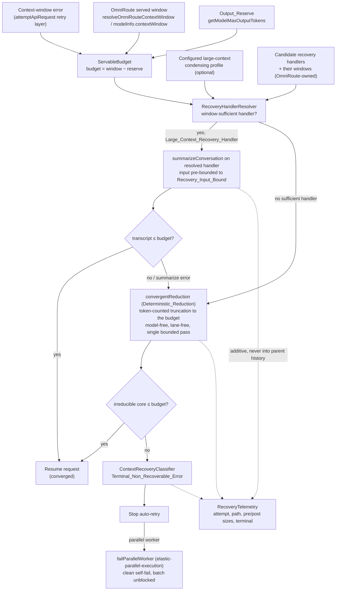
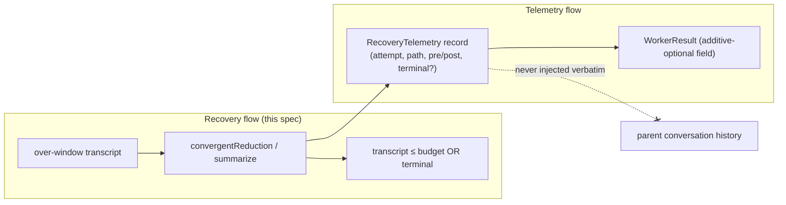

# Design Document

## Overview

This feature is the **Resilient Context Recovery** amendment to the Menagerie Autonomous Operations Lift. It closes the live production incident in which a parallel reader worker on the `reader.fast` lane (OmniRoute route `hybrid/fast`, served window 32768 tokens) accumulated a ~360K-token transcript, failed every request with a context-window error, and — because parallel workers always auto-retry and no operator can answer an `api_req_failed` ask — retried relentlessly until the batch stalled.

The design adds a thin **recovery decision layer** that threads through the two existing recovery entry points already in the tree:

- `Task.handleContextWindowExceededError()` in `src/core/task/Task.ts`, which today force-truncates to `FORCED_CONTEXT_REDUCTION_PERCENT = 75` and retries up to `MAX_CONTEXT_WINDOW_RETRIES = 3`; and
- `manageContext()` in `src/core/context-management/index.ts` → `summarizeConversation()` in `src/core/condense/index.ts`, which takes a single `apiHandler`.

Every addition is **additive** and **minimal-blast-radius**. The design changes neither the sliding-window algorithm, `summarizeConversation`'s LLM mechanics, the `WorkerResult` base contract (owned by `mastermind-execution-metadata`), the scheduler/self-fail mechanics (owned by `elastic-parallel-execution`), nor OmniRoute's route→model/window mapping (owned by `omniroute.ts` / capability-lanes-routing). It is built from four pure, testable pieces plus their wiring:

1. **`ServableBudget`** — the pure arithmetic that computes `Servable_Input_Budget = Served_Context_Window − Output_Reserve` from the OmniRoute-exposed window and the request's output reserve. No fixed window size is hard-coded; the window comes from `resolveOmniRouteContextWindow` / the handler's model info.
2. **`RecoveryHandlerResolver`** — a pure resolution that selects a **`Large_Context_Recovery_Handler`** (a window-sufficient handler, preferring a configured large-context condensing profile) or, when none is window-sufficient, returns the **`Deterministic_Reduction`** path. It is selected independently of the failing lane's window, so a task on a too-small lane is not forced to summarize through the lane it is escaping.
3. **`convergentReduction`** — a model-free, token-counted truncation to a target (the `Servable_Input_Budget`, or the `Recovery_Input_Bound` of the recovery handler), proven to reach the target in a single bounded pass. Summarization becomes an *optimization on top* of this floor, never the thing convergence depends on.
4. **`ContextRecoveryClassifier`** — the decision that, when even the minimal irreducible transcript exceeds the budget, emits a classified **`Terminal_Non_Recoverable_Error`** that stops auto-retry and lets a parallel worker self-fail cleanly through the existing `failParallelWorker` path.

Plus **`RecoveryTelemetry`** — additive-optional metadata on the worker result, consistent with the `WorkerResult` contract, never injected verbatim into the parent model's conversation history.

The governing principle is **recovery converges or terminates — it never loops.** A single deterministic truncation to the servable budget closes any over-size ratio in one bounded pass; summarization is tried first for quality, but the deterministic floor guarantees convergence even when every LLM call on the lane fails.

### Verified codebase grounding

| Element | Location | How this design uses it |
| --- | --- | --- |
| `handleContextWindowExceededError(requestModelInfo)`; `FORCED_CONTEXT_REDUCTION_PERCENT = 75`; `MAX_CONTEXT_WINDOW_RETRIES = 3` | `src/core/task/Task.ts` | The force-truncate-75%/retry-×3 path is the R2 convergence defect. This design **replaces the fixed 75% target with a budget-derived target** passed into `manageContext`, and treats the retry cap as a function of the gap (a single convergent pass suffices). The method signature and `requestModelInfo` snapshot are preserved. |
| `getCondensingApiHandler()` (the `this.api` fallback when `condensingApiConfigId` is unset/missing) | `src/core/task/Task.ts` | The R1 lane-independence defect: recovery falls back to the task's own (too-small) handler. This design inserts an **additive resolution step** that prefers a window-sufficient `Large_Context_Recovery_Handler` (the configured large-context profile if present) and otherwise signals the `Deterministic_Reduction` path — without breaking the existing single-handler return contract. |
| `manageContext(ContextManagementOptions)`; `ContextManagementOptions.apiHandler` (single handler); `TOKEN_BUFFER_PERCENTAGE`, `TRUNCATION_TARGET_PERCENTAGE`, `getAdaptiveTruncationMessageCount` | `src/core/context-management/index.ts` | Recovery reuses `manageContext` unchanged for the condense-then-truncate flow; the design supplies a **budget-derived `autoCondenseContextPercent`/target** rather than the fixed `FORCED_CONTEXT_REDUCTION_PERCENT`, and reuses the existing token-counted adaptive truncation as the `Deterministic_Reduction` mechanism. The single `apiHandler` parameter is the seam the resolved recovery handler flows through. |
| `summarizeConversation(SummarizeConversationOptions)`; `SummarizeConversationOptions.apiHandler`; `SummarizeResponse.{error,retryable}` | `src/core/condense/index.ts` | The summarization call runs on the **resolved recovery handler**, not the failing handler. The existing `error`/`retryable` surface is how the design detects "summarize failed or did not reach budget" and falls through to `Deterministic_Reduction`. The summarizer's internal prompt/stream mechanics are unchanged. |
| `OMNIROUTE_ROUTE_CONTEXT_WINDOWS`; `resolveOmniRouteContextWindow(routeId, customContextWindow?)` | `src/api/providers/omniroute.ts` | The authoritative `Served_Context_Window` source. Recovery derives every budget/bound from this (or the handler's model info window), never from a hard-coded constant. `hybrid/fast` → 32768 is the incident's served window. |
| `getModelMaxOutputTokens(...)`; `this.api.getCondenseContextWindow?.()` fallback to `modelInfo.contextWindow` | `src/core/task/Task.ts` (inside `handleContextWindowExceededError`) | `getModelMaxOutputTokens` supplies the `Output_Reserve`; `getCondenseContextWindow` / `modelInfo.contextWindow` is the window input to `ServableBudget`. Both are read exactly as the existing method already reads them. |
| `failParallelWorker(reason)`; `failWorkerIfRetriesExhausted(error)`; `PARALLEL_WORKER_MAX_API_RETRIES = 8`; the `parallelWorker` auto-retry branch in `attemptApiRequest` | `src/core/task/Task.ts` | The `Terminal_Non_Recoverable_Error` reuses the existing `failParallelWorker` self-fail path; this design adds a terminal classification that short-circuits the context-window retry loop **before** it idles against the retry cap, rather than inventing a new termination mechanism. |
| `STATIC_ROUTE_CAPACITY` / `OMNIROUTE_ROUTE_CONTEXT_WINDOWS` "source of truth" lockstep comment style | `src/core/task/routeCapacityMap.ts`, `src/api/providers/omniroute.ts` | The recovery handler candidate set and its windows are documented in the same "mirrors OmniRoute serving config, kept in lockstep" style; recovery never introduces its own window literals. |

### Cross-spec contracts consumed (not redefined)

- **capability-lanes-routing**: `CapabilityLane`; the principle that OmniRoute owns the lane→model/window resolution; the lane→window relationship exposed via `resolveOmniRouteContextWindow`. This spec consumes a lane's `Served_Context_Window` read-only and defines recovery *relative to* that window. It does **not** change lane selection, lane→model mapping, or the reason a task is on a lane.
- **elastic-parallel-execution**: `failParallelWorker` / parallel-worker self-fail semantics; the `PARALLEL_WORKER_MAX_API_RETRIES = 8` auto-retry budget; the worker termination contract. This spec defines the terminal, non-recoverable classification a worker reaches and relies on that spec's self-fail mechanics to unblock the batch; it does **not** change the scheduler, the `RouteCapability` enum, or the retry cap itself.
- **mastermind-execution-metadata**: the `WorkerResult` contract. This spec emits `Recovery_Telemetry` as additive-optional metadata consistent with that contract; it does **not** modify or remove any base `WorkerResult` field.
- **progress-aware-loop-detection**: the absolute turn/transcript backstop remains that spec's concern. This spec recovers from context-window overflow specifically and adds **no** turn/transcript backstop.

## Architecture

Recovery is an advisory decision layer wrapped around the two existing entry points. For a request that exceeds its served window: `ServableBudget` computes the convergence target from the OmniRoute window minus the output reserve; `RecoveryHandlerResolver` picks a window-sufficient recovery handler (or the deterministic path); the summarize call — if a handler was found — runs on *that* handler with its input bounded to the handler's `Recovery_Input_Bound`; and `convergentReduction` guarantees the transcript lands at or below the budget in one bounded pass whether or not the summarize succeeded. If the minimal irreducible transcript still exceeds the budget, `ContextRecoveryClassifier` emits a `Terminal_Non_Recoverable_Error` that stops retry and self-fails a parallel worker.



### Where the layer hooks relative to the existing code

- **Budget-derived target replaces the fixed 75%.** Inside `handleContextWindowExceededError`, the call to `manageContext` currently passes `autoCondenseContextPercent: FORCED_CONTEXT_REDUCTION_PERCENT`. The design computes the `Servable_Input_Budget` from the same `contextWindow`/`maxTokens` the method already reads (`getCondenseContextWindow?.() ?? modelInfo.contextWindow`, `getModelMaxOutputTokens`) and derives the reduction target from the budget. The `manageContext` signature, the adaptive truncation, and the `say("condense_context")` / `say("sliding_window_truncation")` reporting are untouched.
- **Additive resolution step on top of `getCondensingApiHandler`.** The existing method still returns a single `ApiHandler` (its callers are unchanged). The design adds a resolver that *wraps* this method's result: it keeps the configured large-context profile when that profile's window is sufficient, and otherwise reports that recovery must use `Deterministic_Reduction`. Existing single-handler callers of `getCondensingApiHandler` continue to receive exactly what they do today; only `handleContextWindowExceededError` consults the resolver's additional signal.
- **Terminal classification short-circuits the retry loop.** In `attemptApiRequest`, the context-window branch (`isContextWindowExceededError && retryAttempt < MAX_CONTEXT_WINDOW_RETRIES`) calls `handleContextWindowExceededError` and recurses. The design has `handleContextWindowExceededError` surface a terminal signal when the transcript cannot be brought under budget; the retry branch then declines to recurse and, for a parallel worker, routes to `failParallelWorker` — reusing the existing self-fail path rather than exhausting `PARALLEL_WORKER_MAX_API_RETRIES`.
- **Telemetry rides additively on the worker result.** Recovery records are attached as optional metadata consistent with `WorkerResult`; the parent continues to receive only its compacted summary, which never carries the verbatim telemetry block.

### Lane independence: recovery is not bound to the failing lane

The incident's root cause is that recovery routed its summarize call through the *same* handler and lane as the failing task. `getCondensingApiHandler` falls back to `this.api` whenever no `condensingApiConfigId` is configured, so on `hybrid/fast` (32768) the summarize request — which must carry the oversized ~360K history as input — fails for the same reason the original request failed. This design makes recovery-handler selection a property of **required recovery-input size vs. candidate windows**, not of the failing lane:

- A **`Large_Context_Recovery_Handler`** is any candidate whose context window ≥ the `Recovery_Input_Bound`. A configured large-context condensing profile (e.g. an OmniRoute planner/long route at 262144) is preferred when present and sufficient (Req 1.5).
- Selection is **independent of the failing lane's `Served_Context_Window`** (Req 1.2): two tasks differing only in their failing lane's window resolve to the same recovery handler for the same transcript.
- When **no candidate is window-sufficient**, recovery falls to **`Deterministic_Reduction`** (Req 1.3), which depends on no model and no lane — guaranteeing a task on a too-small lane can always escape.

### Convergence: one bounded deterministic pass closes any gap

The old path reduces by a fixed 25% per retry capped at three attempts. From 360K that reaches ~152K — still ~5× a 32K window — so the worker exhausts its budget while still over the window. The fix targets the **servable budget**, not a fraction of current size:

- `Servable_Input_Budget = Served_Context_Window − Output_Reserve` (Req 2.1), derived entirely from the OmniRoute-exposed window and the request's `getModelMaxOutputTokens` reserve (Req 2.4) — no hard-coded window literal.
- `convergentReduction` is a **token-counted truncation to the budget**: it removes oldest history (reusing the existing `getAdaptiveTruncationMessageCount` discipline — preserve the first task message and the two newest visible messages) until the counted token total is ≤ the budget. Because it targets an absolute token count rather than a fixed fraction, a **single bounded pass** reaches ≤ budget for *any* starting size (Req 2.2, 2.3, 3.1, 3.3, 3.4).
- Summarization is tried first for quality; if it errors or does not reach the budget, `Deterministic_Reduction` runs and guarantees convergence (Req 2.5). Convergence therefore never depends on a successful LLM call.
- The only case `convergentReduction` cannot satisfy is when the **minimal irreducible transcript** (first task message + the two newest visible messages, which truncation never removes) itself exceeds the budget. That is the terminal condition (Req 5.1), not an occasion for further retries.

### Recovery-input bound: the summarize call never overflows

Even a window-sufficient recovery handler must not be handed an input larger than its own window. The design derives a **`Recovery_Input_Bound`** from the *selected recovery handler's* window minus its output reserve (Req 4.3) and pre-reduces the summarizer input through `Deterministic_Reduction` whenever the raw input exceeds that bound (Req 4.2). The summarize call is therefore never issued with an input known to exceed the handler's window (Req 4.1, 4.4). For the deterministic path there is no LLM call, so the bound is the `Servable_Input_Budget` of the failing lane directly.

### Terminal behavior: classify and self-fail, never loop

When `convergentReduction` cannot bring the irreducible core under the budget, `ContextRecoveryClassifier` produces a `Terminal_Non_Recoverable_Error` tagged as a non-recoverable context-window overflow — distinct from a transient API failure (Req 5.4). The context-window retry branch in `attemptApiRequest` reads this classification and stops recursing (Req 5.2, 5.5). For a parallel worker, the terminal outcome routes to the existing `failParallelWorker(reason)` so the worker self-fails cleanly and the batch is unblocked (Req 5.3), rather than idling against `PARALLEL_WORKER_MAX_API_RETRIES`. Because convergence otherwise succeeds in one pass, the loop provably halts in a bounded number of steps for every transcript.

### Telemetry: additive, never injected into parent history

Recovery emits a machine-readable `Recovery_Telemetry` record per attempt (Req 6.1) carrying the chosen handler and path (large-context vs. deterministic, Req 6.2), the pre- and post-reduction token sizes (Req 6.3), and a terminal event when a `Terminal_Non_Recoverable_Error` is declared (Req 6.4). It is attached as additive-optional metadata consistent with `WorkerResult`, preserving every base field (Req 6.5), and is **never** injected verbatim into the parent model's conversation history (Req 6.6) — the parent sees only its compacted summary, exactly as today.



## Components and Interfaces

### `ServableBudget`

A pure function deriving the convergence target from the OmniRoute-exposed window and the output reserve. No window literal is embedded (Req 2.1, 2.4).

```ts
export interface ServableBudgetInput {
	/** Served_Context_Window for the lane, from resolveOmniRouteContextWindow / modelInfo.contextWindow. */
	servedContextWindow: number
	/** Output_Reserve for the request, from getModelMaxOutputTokens. */
	outputReserve: number
}

/**
 * Servable_Input_Budget = max(0, servedContextWindow - outputReserve) (Req 2.1).
 * Pure; the window is OmniRoute-owned and passed in — never hard-coded (Req 2.4).
 */
export function computeServableInputBudget(input: ServableBudgetInput): number {
	return Math.max(0, input.servedContextWindow - input.outputReserve)
}
```

### `RecoveryHandlerResolver`

A pure resolution over the candidate recovery handlers and the required recovery-input size. It never consults the failing lane's window (Req 1.2) and never returns a too-small handler (Req 1.4).

```ts
export interface RecoveryHandlerCandidate {
	/** Opaque id for telemetry; never a model/GPU identity branch target. */
	id: string
	/** The candidate's context window (OmniRoute-owned), from its resolved route/model info. */
	contextWindow: number
	/** The candidate's output reserve, so its Recovery_Input_Bound = contextWindow - outputReserve. */
	outputReserve: number
	/** True iff this candidate is the configured large-context condensing profile (Req 1.5). */
	configuredLargeContextProfile: boolean
}

export interface RecoveryHandlerResolution {
	/** "large-context" when a window-sufficient handler was found; "deterministic" otherwise (Req 1.3). */
	path: "large-context" | "deterministic"
	/** The chosen handler id and its Recovery_Input_Bound, present iff path === "large-context". */
	handlerId?: string
	recoveryInputBound?: number
}

export interface RecoveryHandlerResolverInput {
	/** Minimum input the recovery call must carry (the current transcript token count). */
	requiredRecoveryInput: number
	/** Candidate handlers; the failing lane's window is intentionally NOT part of this input (Req 1.2). */
	candidates: readonly RecoveryHandlerCandidate[]
}

/**
 * Chooses a Large_Context_Recovery_Handler whose Recovery_Input_Bound ≥ requiredRecoveryInput,
 * preferring the configured large-context profile (Req 1.1, 1.5); otherwise returns the
 * Deterministic_Reduction path (Req 1.3). Never returns a handler whose bound is below the
 * required input (Req 1.4). Pure — no I/O, no lane window consulted (Req 1.2).
 */
export function resolveRecoveryHandler(input: RecoveryHandlerResolverInput): RecoveryHandlerResolution
```

The resolver computes each candidate's `Recovery_Input_Bound = contextWindow − outputReserve` (Req 4.3), keeps those ≥ `requiredRecoveryInput`, prefers a `configuredLargeContextProfile` among them (Req 1.5) and otherwise the one with the largest bound, and returns `{ path: "deterministic" }` when none qualifies (Req 1.3). In `Task`, the candidate set is seeded from `getCondensingApiHandler()`'s resolved profile plus the task's own handler; the resolver's result decides whether the summarize call runs and on which handler, leaving `getCondensingApiHandler`'s single-handler return contract intact.

### `convergentReduction` (Deterministic_Reduction)

A model-free, lane-free token-counted truncation to a target token count, proven to converge in one bounded pass (Req 2.2, 2.3, 2.5, 3.1, 3.3, 3.4). It reuses the existing adaptive-truncation discipline from `context-management/index.ts`.

```ts
export interface ConvergentReductionInput {
	messages: ApiMessage[]
	/** Current counted token total of `messages`. */
	currentTokens: number
	/** The target the transcript must land at or below (Servable_Input_Budget or Recovery_Input_Bound). */
	targetTokens: number
	/** Token counter (apiHandler.countTokens) — the only external dependency; no model call. */
	countTokens: (messages: ApiMessage[]) => Promise<number>
}

export interface ConvergentReductionResult {
	messages: ApiMessage[]
	/** Counted tokens after reduction; ≤ targetTokens unless the irreducible core exceeds it. */
	resultTokens: number
	/** True iff resultTokens ≤ targetTokens (converged); false iff the irreducible core exceeds target. */
	converged: boolean
	/** Pre-reduction token total, for telemetry (Req 6.3). */
	prevTokens: number
}

/**
 * Removes oldest removable history (preserving the first task message and the two newest visible
 * messages, matching getAdaptiveTruncationMessageCount) until the counted total ≤ targetTokens, in
 * a single bounded pass. Depends on no model and no lane (Req 1.3, 2.5). When the minimal irreducible
 * transcript still exceeds targetTokens, returns converged:false (the Req 5.1 terminal condition).
 */
export async function convergentReduction(input: ConvergentReductionInput): Promise<ConvergentReductionResult>
```

### `ContextRecoveryClassifier`

A pure decision mapping a recovery outcome to either "resume" or a classified terminal error (Req 5.1, 5.2, 5.4). It drives whether the context-window retry branch recurses or stops.

```ts
export type RecoveryOutcome =
	| { kind: "converged"; postTokens: number }
	| { kind: "non-recoverable"; irreducibleTokens: number; budget: number }

/** Distinct from a transient API failure so callers can branch on classification (Req 5.4). */
export const CONTEXT_OVERFLOW_NON_RECOVERABLE = "context-window-overflow-non-recoverable" as const

export interface TerminalContextError {
	classification: typeof CONTEXT_OVERFLOW_NON_RECOVERABLE
	irreducibleTokens: number
	budget: number
	message: string
}

export interface RetryDecision {
	/** false ⇒ the context-window retry branch must not recurse (Req 5.2, 5.5). */
	retry: boolean
	terminalError?: TerminalContextError
}

/** Pure. converged ⇒ retry:true (resume once under budget); non-recoverable ⇒ retry:false + terminal. */
export function classifyRecoveryOutcome(outcome: RecoveryOutcome): RetryDecision
```

In `Task.attemptApiRequest`, a `retry:false` + `terminalError` short-circuits the `isContextWindowExceededError` branch: a non-worker task throws the classified terminal error; a parallel worker calls `failParallelWorker(terminalError.message)` (Req 5.3), reusing the existing clean self-fail path.

### `RecoveryTelemetry`

Additive-optional metadata on the worker result, mirroring the discipline of the sibling `RoutingMetadata` extension. Never injected verbatim into parent history (Req 6.5, 6.6).

```ts
export interface RecoveryAttemptTelemetry {
	/** Which path recovery took for this attempt (Req 6.2). */
	path: "large-context" | "deterministic"
	/** Chosen recovery handler id when path === "large-context" (Req 6.2). */
	handlerId?: string
	/** Transcript token sizes around the reduction (Req 6.3); postTokens ≤ preTokens. */
	preTokens: number
	postTokens: number
	/** Set on the attempt that declares a Terminal_Non_Recoverable_Error (Req 6.4). */
	terminal?: { classification: typeof CONTEXT_OVERFLOW_NON_RECOVERABLE }
}

export interface RecoveryTelemetry {
	/** One entry per recovery attempt (Req 6.1). Absent ⇒ no recovery occurred (never an error). */
	attempts: RecoveryAttemptTelemetry[]
}

/** Additive-optional on WorkerResult; base contract unchanged (Req 6.5). */
export interface WorkerResultWithRecovery extends WorkerResult {
	recovery?: RecoveryTelemetry
}
```

`RecoveryTelemetry` is machine-readable and consumed by OmniRoute/NerveCenter. It is attached to the worker result only; the parent-visible compacted summary (produced by the existing `compactParallelTasksResultForParent` path) does not carry the `recovery` block (Req 6.6).

## Data Models

```ts
// ── Budget ─────────────────────────────────────────────────────────────────
interface ServableBudgetInput { servedContextWindow: number; outputReserve: number }
// computeServableInputBudget(input) -> number   // max(0, window - reserve)

// ── Recovery-handler resolution ──────────────────────────────────────────────
interface RecoveryHandlerCandidate {
	id: string
	contextWindow: number
	outputReserve: number
	configuredLargeContextProfile: boolean
}
interface RecoveryHandlerResolverInput {
	requiredRecoveryInput: number
	candidates: readonly RecoveryHandlerCandidate[]
}
interface RecoveryHandlerResolution {
	path: "large-context" | "deterministic"
	handlerId?: string
	recoveryInputBound?: number
}

// ── Convergent (deterministic) reduction ─────────────────────────────────────
interface ConvergentReductionInput {
	messages: ApiMessage[]
	currentTokens: number
	targetTokens: number
	countTokens: (messages: ApiMessage[]) => Promise<number>
}
interface ConvergentReductionResult {
	messages: ApiMessage[]
	resultTokens: number
	converged: boolean
	prevTokens: number
}

// ── Terminal classification ──────────────────────────────────────────────────
type RecoveryOutcome =
	| { kind: "converged"; postTokens: number }
	| { kind: "non-recoverable"; irreducibleTokens: number; budget: number }
const CONTEXT_OVERFLOW_NON_RECOVERABLE = "context-window-overflow-non-recoverable"
interface TerminalContextError {
	classification: typeof CONTEXT_OVERFLOW_NON_RECOVERABLE
	irreducibleTokens: number
	budget: number
	message: string
}
interface RetryDecision { retry: boolean; terminalError?: TerminalContextError }

// ── Telemetry (additive-optional on WorkerResult) ────────────────────────────
interface RecoveryAttemptTelemetry {
	path: "large-context" | "deterministic"
	handlerId?: string
	preTokens: number
	postTokens: number
	terminal?: { classification: typeof CONTEXT_OVERFLOW_NON_RECOVERABLE }
}
interface RecoveryTelemetry { attempts: RecoveryAttemptTelemetry[] }
interface WorkerResultWithRecovery extends WorkerResult { recovery?: RecoveryTelemetry }
```

**Reconciliation with existing types.** `ApiMessage` is consumed from `core/task-persistence/apiMessages`. `ApiHandler` and its `countTokens`/`getModel`/`getCondenseContextWindow` surface, `getModelMaxOutputTokens`, and `resolveOmniRouteContextWindow`/`OMNIROUTE_ROUTE_CONTEXT_WINDOWS` are consumed unchanged. `WorkerResult` is consumed read-only from `mastermind-execution-metadata`; `RecoveryTelemetry` is an additive-optional extension preserving every base field. `manageContext`/`ContextManagementOptions` and `summarizeConversation`/`SummarizeConversationOptions` keep their current single-`apiHandler` signatures; the recovery handler flows through that existing parameter.

## Correctness Properties

*A property is a characteristic or behavior that should hold true across all valid executions of a system — essentially, a formal statement about what the system should do. Properties serve as the bridge between human-readable specifications and machine-verifiable correctness guarantees.*

Each entry below is universally quantified and names the acceptance criteria it validates. These guide the generated-input tests described in the Testing Strategy.

### Property 1: Recovery-handler resolution is window-sufficient, lane-independent, and prefers the configured profile

*For any* set of `RecoveryHandlerCandidate`s and any `requiredRecoveryInput`, `resolveRecoveryHandler` returns a `large-context` handler only when that handler's `Recovery_Input_Bound` (`contextWindow − outputReserve`) is at or above `requiredRecoveryInput`; it returns the `deterministic` path when no candidate qualifies; it never returns a handler whose bound is below the required input; when a `configuredLargeContextProfile` candidate qualifies it is the one chosen; and the result is unchanged when inputs differ only in the failing lane's `Served_Context_Window` (which is not part of the resolver input).

**Validates: Requirements 1.1, 1.2, 1.3, 1.4, 1.5**

### Property 2: The servable budget is exactly the window minus the reserve

*For any* `servedContextWindow` and `outputReserve`, `computeServableInputBudget` returns `max(0, servedContextWindow − outputReserve)` — exactly the window minus the reserve, clamped non-negative — and depends on no other quantity.

**Validates: Requirements 2.1**

### Property 3: The reduction target is derived from the OmniRoute window with no hard-coded size

*For any* resolved `Served_Context_Window` and selected recovery-handler window, the convergence target (`Servable_Input_Budget`) and the `Recovery_Input_Bound` track the respective window minus its reserve; feeding two inputs that differ only in the resolved window yields proportionally different targets, and no fixed context-window literal participates in the computation.

**Validates: Requirements 2.4, 4.3**

### Property 4: Convergent reduction reaches the budget in one bounded pass regardless of over-size ratio

*For any* transcript whose counted tokens exceed the target and whose irreducible core (first task message plus the two newest visible messages) is at or below the target, `convergentReduction` produces a transcript whose counted tokens are at or below the target in a single bounded pass — independent of the starting Over_Size_Ratio — and this holds whether or not a prior summarization succeeded, so convergence never depends on an LLM call.

**Validates: Requirements 2.2, 2.3, 2.5, 3.1, 3.3, 3.4**

### Property 5: The summarizer input never exceeds the recovery handler's window

*For any* recovery input and selected recovery handler, the input handed to the summarization call is at or below the handler's `Recovery_Input_Bound`: inputs above the bound are pre-reduced through `Deterministic_Reduction` before the call, inputs at or below it are passed unchanged, and no summarization call is issued with an input known to exceed the handler's window.

**Validates: Requirements 4.1, 4.2, 4.4**

### Property 6: Context-window recovery always halts — converge or terminate, never unbounded retry

*For any* over-window transcript, the recovery-and-retry loop reaches, in a bounded number of steps, either a transcript at or below the `Servable_Input_Budget` (resume) or a `Terminal_Non_Recoverable_Error` (stop); it never idles above the budget while automatic retries remain and further reduction is possible, so a context-window overflow can never produce an unbounded sequence of automatic retries.

**Validates: Requirements 3.2, 5.5**

### Property 7: A non-recoverable outcome stops retry and is classified distinctly from a transient failure

*For any* `RecoveryOutcome`, `classifyRecoveryOutcome` returns `retry:false` with a `TerminalContextError` if and only if the outcome is non-recoverable; the terminal error carries the `CONTEXT_OVERFLOW_NON_RECOVERABLE` classification, which is distinct from a transient API-failure classification; and a converged outcome returns `retry:true` with no terminal error.

**Validates: Requirements 5.1, 5.2, 5.4**

### Property 8: Telemetry faithfully records every recovery attempt and the terminal event

*For any* sequence of recovery attempts, `RecoveryTelemetry` contains exactly one record per attempt, each record's `path` matches the actual resolution outcome (`large-context` names the chosen handler; `deterministic` otherwise), each record's `postTokens` is at or below its `preTokens` and both equal the measured sizes, and a `Terminal_Non_Recoverable_Error` declaration produces exactly one record carrying the terminal classification.

**Validates: Requirements 6.1, 6.2, 6.3, 6.4**

### Property 9: Recovery telemetry is additive-optional on WorkerResult and never injected verbatim into the parent

*For any* valid base `WorkerResult`, the value validates as a `WorkerResultWithRecovery` with or without a `recovery` field (every base field preserved), reading an absent `recovery` field yields unset rather than throwing, and *for any* `RecoveryTelemetry`, the parent-visible compacted result never contains the verbatim telemetry block.

**Validates: Requirements 6.5, 6.6**

## Error Handling

- **No window-sufficient recovery handler (Req 1.3).** Not an error: `resolveRecoveryHandler` returns `{ path: "deterministic" }` and `convergentReduction` guarantees convergence with no model call. A task on a too-small lane always has an escape.
- **Summarization fails or does not reach the budget (Req 2.5).** The existing `SummarizeResponse.{error, retryable}` surface is read; recovery falls through to `convergentReduction`, which brings the transcript to the budget deterministically. The one transient-retry already in `manageContext` is preserved; it is an optimization, not the convergence guarantee.
- **Recovery input exceeds the recovery handler's window (Req 4.2, 4.4).** The input is pre-reduced through `Deterministic_Reduction` to the handler's `Recovery_Input_Bound` before the summarize call; a call with an input known to exceed the window is never issued.
- **Irreducible core exceeds the budget (Req 5.1).** The minimal transcript (first task message + two newest visible messages, which truncation never removes) cannot be reduced further. `convergentReduction` returns `converged:false`; `classifyRecoveryOutcome` emits a `Terminal_Non_Recoverable_Error`.
- **Terminal error on a parallel worker (Req 5.3).** Routed to the existing `failParallelWorker(reason)`; the worker self-fails cleanly and the batch is unblocked, rather than exhausting `PARALLEL_WORKER_MAX_API_RETRIES`.
- **Terminal error on a non-worker task (Req 5.2).** The context-window retry branch stops recursing and the classified terminal error propagates; auto-retry does not continue.
- **Absent `recovery` telemetry field (Req 6.5).** Never an error: a consumer treats a missing `recovery` (or a missing attempt sub-field) as unset. An absent field means no recovery occurred.
- **Transient API failure mistaken for overflow.** Impossible by classification: `CONTEXT_OVERFLOW_NON_RECOVERABLE` is distinct from the transient-failure path, so a transient failure never triggers terminal self-fail and a true overflow never masquerades as transient (Req 5.4).

## Testing Strategy

Per AGENTS.md, coverage sits at the **narrowest layer** that proves the behavior. The budget arithmetic, handler resolution, convergent-reduction math, terminal classification, and telemetry shape are pure or near-pure and belong in **`src` package-local unit tests** plus **`fast-check` property tests**; the two wiring boundaries (recovery threading through `handleContextWindowExceededError`/`manageContext`, and the terminal → `failParallelWorker` self-fail) are covered with small integration tests using faked collaborators. No `apps/vscode-e2e` test is added because no behavior requires the real extension host, and **no `webview-ui` test is added because this feature touches no UI** (the existing `condenseTaskContextStarted`/`Response` webview messages are reused unchanged).

**Unit + property tests (`src`), using `fast-check` with a minimum of 100 iterations per property.** Each property test is tagged `// Feature: resilient-context-recovery, Property {N}: {property text}` and references its design property.

- **`resolveRecoveryHandler`** — generated candidate sets and required-input sizes: window-sufficiency, deterministic fallback, never-too-small, configured-profile preference, and failing-lane-window invariance (Property 1).
- **`computeServableInputBudget`** — generated windows/reserves: result equals `max(0, window − reserve)` (Property 2); window-derivation with no literal, shared with the recovery-input bound (Property 3).
- **`convergentReduction`** — generated over-budget transcripts (including incident-scale ratios like 360K→32K) with a faked `countTokens`: single-pass convergence to ≤ target independent of ratio, and convergence regardless of a modeled summarize success/failure (Property 4); irreducible-core edge case producing `converged:false` (feeds Property 6/7); bounded-halt over the modeled loop (Property 6).
- **recovery-input bound** — generated inputs above/below the bound: pre-reduction applied iff above, issued input always ≤ bound (Property 5).
- **`classifyRecoveryOutcome`** — generated outcomes: `retry:false`+terminal iff non-recoverable, terminal classification distinct from transient, converged ⇒ `retry:true` (Property 7).
- **`RecoveryTelemetry`** — generated attempt sequences: one record per attempt, path/handler fidelity, `postTokens ≤ preTokens` equal to measured sizes, one terminal record (Property 8); additive-optional round trip over generated base `WorkerResult`s with absent-field-is-unset and parent-view exclusion of the verbatim block (Property 9).

**Integration tests (`src`), with faked collaborators from `src/test-utils`.**

- Recovery threading: drive `handleContextWindowExceededError` against a faked `Task` whose `getCondensingApiHandler`/`manageContext` collaborators are observable, asserting the budget-derived target replaces the fixed 75% and the resolved recovery handler (not the failing handler) carries the summarize call when a window-sufficient profile exists.
- Terminal self-fail: fake a parallel worker and assert a `Terminal_Non_Recoverable_Error` triggers `failParallelWorker` exactly once with a context-overflow reason, and that the context-window retry branch stops recursing — cross-referencing `elastic-parallel-execution` for the self-fail mechanics rather than re-testing them.

**Cross-references instead of duplication.** The `WorkerResult` base contract and its normalizer are covered by `mastermind-execution-metadata`; the parallel-worker self-fail/abort mechanics and the retry cap by `elastic-parallel-execution`; the OmniRoute route→window mapping by `omniroute.ts`/capability-lanes-routing; the absolute turn/transcript backstop by `progress-aware-loop-detection`. This spec's tests consume faked versions of those contracts and assert only the recovery-layer behavior.

**Commands (from the `src` package directory).**

```bash
npx vitest run src/core/task/__tests__/resilientContextRecovery.spec.ts
pnpm --dir src exec eslint --prune-suppressions --max-warnings=0 src/core/task/<new-files>
```
